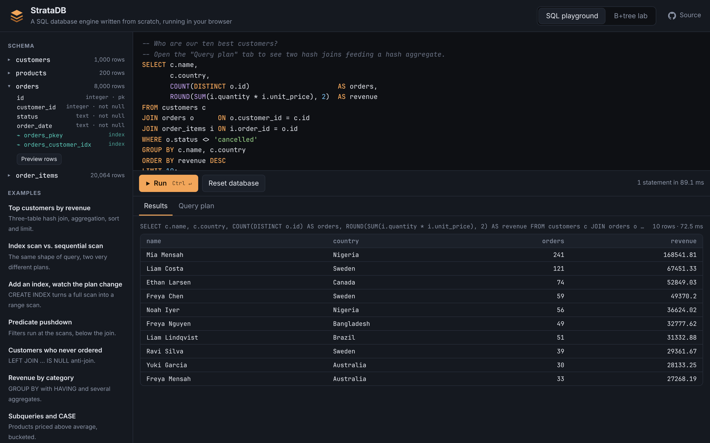
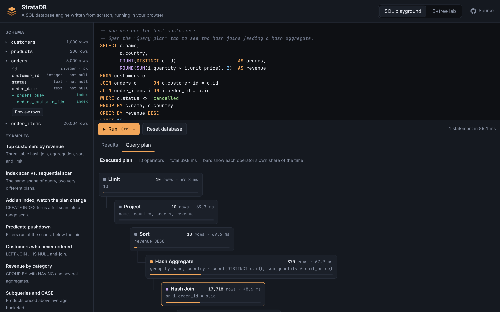
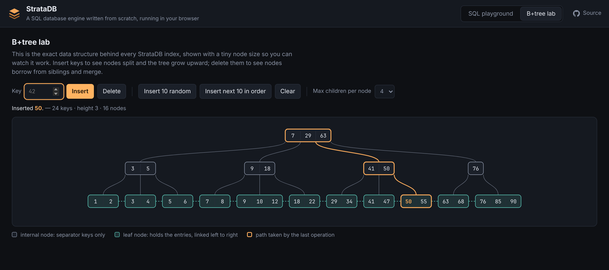
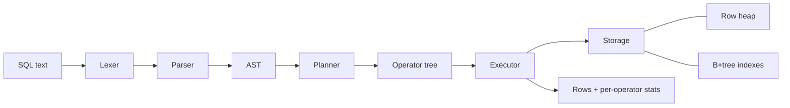

# StrataDB

**A relational database engine written from scratch in TypeScript — SQL parser, query planner, B+tree indexes and transactions — running entirely in your browser.**

[](https://github.com/nuhanhabib/stratadb/actions/workflows/ci.yml)


**[Try the live playground →](https://nuhanhabib.github.io/stratadb/)**



StrataDB takes a string of SQL and does everything a database does with it: tokenizes it, parses
it into a syntax tree, plans how to execute it, and runs that plan against tables stored in
memory and indexed by B+trees. No SQLite compiled to WebAssembly, no parser generator, no
libraries at all — every layer is hand-written and small enough to read in an afternoon.

The playground loads a 30,000-row e-commerce dataset and shows you not just the answer to a
query but *how* the engine got it.

## What it shows

### The query plan, as executed

Every `SELECT` reports the operator tree it ran, with the rows each operator produced and where
the time went. Here the planner has pushed the `status` filter below the joins, chosen hash joins
for the equality conditions, and the highlighted node is the slowest operator.



### The B+tree, live

Indexes are B+trees. The lab runs the engine's real implementation with a tiny node size so you
can watch nodes split on insert, and borrow or merge on delete.



## Supported SQL

| Area | Features |
| --- | --- |
| Queries | `SELECT`, `DISTINCT`, `WHERE`, `GROUP BY`, `HAVING`, `ORDER BY`, `LIMIT` / `OFFSET`, column and table aliases |
| Joins | `INNER`, `LEFT`, `CROSS`, comma joins, self joins, any number of tables |
| Expressions | arithmetic, comparisons, `AND` / `OR` / `NOT` with three-valued `NULL` logic, `LIKE`, `IN`, `BETWEEN`, `IS NULL`, `CASE`, `\|\|` |
| Functions | `COUNT` `SUM` `AVG` `MIN` `MAX` (with `DISTINCT`), `UPPER` `LOWER` `LENGTH` `TRIM` `SUBSTR` `ROUND` `ABS` `FLOOR` `CEIL` `COALESCE` `NULLIF` |
| Subqueries | uncorrelated scalar subqueries and `IN (SELECT ...)` |
| Data changes | `INSERT` (multi-row), `UPDATE`, `DELETE` |
| Schema | `CREATE TABLE` with `PRIMARY KEY`, `NOT NULL`, `UNIQUE`, `DEFAULT`; `CREATE [UNIQUE] INDEX`; `DROP TABLE` / `DROP INDEX` |
| Transactions | `BEGIN`, `COMMIT`, `ROLLBACK` — covering data *and* schema changes |
| Introspection | `EXPLAIN` and `EXPLAIN ANALYZE` |

## How it works



| Layer | File | What it does |
| --- | --- | --- |
| Lexer | [`lexer.ts`](src/engine/lexer.ts) | Text → tokens. A lenient mode powers the editor's syntax highlighting, so the editor colours SQL exactly the way the engine reads it. |
| Parser | [`parser.ts`](src/engine/parser.ts) | Hand-written recursive descent with precedence climbing for expressions. Errors carry a source position. |
| Planner | [`planner.ts`](src/engine/planner.ts) | Chooses access paths and join algorithms and assembles the operator tree. |
| Expressions | [`expr.ts`](src/engine/expr.ts) | Compiles expression trees into JavaScript closures. |
| Executor | [`plan.ts`](src/engine/plan.ts) | Volcano-style pull operators built on generators. |
| Storage | [`storage.ts`](src/engine/storage.ts) | Tables, constraints, index maintenance, undo logging. |
| B+tree | [`btree.ts`](src/engine/btree.ts) | Insert, delete with rebalancing, and range scans over linked leaves. |

### Design decisions worth a look

**Pull-based execution.** Each operator is a generator that pulls rows from its children on
demand. `SELECT * FROM big LIMIT 5` reads five rows, not the whole table — there is a test
asserting exactly that.

**Expressions are compiled, not interpreted.** `WHERE price * qty > 100` is turned into nested
closures once per query, with column names already resolved to array offsets. Evaluating it per
row involves no tree walking and no name lookups.

**Rule-based optimisation.**
- *Predicate pushdown* — conditions that touch one table are evaluated at that table's scan,
  before any join.
- *Index selection* — pushed-down predicates of the form `column <op> constant` on an indexed
  column become index scans. Multiple range conditions are intersected into one interval
  (`id > 10 AND id <= 20 AND id >= 5` scans `(10, 20]`).
- *Hash joins* — equality join conditions run as hash joins; everything else falls back to
  nested loops.

**Outer joins are handled correctly, not conveniently.** Pushing `WHERE o.id IS NULL` beneath a
`LEFT JOIN` would silently break anti-joins, so the planner tracks which side of each join is
nullable and holds those predicates above it.

**One B+tree for unique and non-unique indexes.** Entries are keyed by `(value, row id)`, which
makes every key unique. An equality lookup is then just a range scan from `(v, -∞)` to `(v, +∞)`.

**Atomicity through an undo log.** Every mutation records its inverse. If a statement fails
half-way — say the third row of an `INSERT` violates a constraint — its earlier effects are
rolled back. `ROLLBACK` replays the same log for the whole transaction, including `DROP TABLE`.

## Testing

```bash
npm test
```

58 tests, including:

- **Model-based testing of the B+tree** — thousands of random inserts and deletes are applied to
  the tree and to a plain `Map`; the two must always agree, and a validator checks every
  structural invariant (ordering, fill factor, uniform depth, separator bounds, leaf chain) along
  the way, across five different node sizes.
- **Differential testing of the planner** — the same queries must return identical results with
  and without an index.
- **Plan assertions** — tests pin the exact plan chosen for representative queries.
- SQL semantics: `NULL` logic, joins, grouping, constraints, statement atomicity, rollback.

## Use it as a library

```ts
import { Database } from './src/engine';

const db = new Database();
db.execute(`
  CREATE TABLE users (id INTEGER PRIMARY KEY, name TEXT NOT NULL, age INTEGER);
  INSERT INTO users (name, age) VALUES ('Ada', 36), ('Grace', 45), ('Linus', 28);
  CREATE INDEX users_age ON users (age);
`);

db.query('SELECT name FROM users WHERE age > 30 ORDER BY name');
// [{ name: 'Ada' }, { name: 'Grace' }]

db.query('EXPLAIN SELECT name FROM users WHERE age > 30');
// Project name
// └─ Index Scan on users using users_age (age > 30)
```

## Run it locally

```bash
npm install
```

```bash
npm run dev
```

`npm run build` produces a static site in `dist/`. Pushing to `main` deploys it to GitHub Pages
via [the included workflow](.github/workflows/deploy.yml).

## Limitations

This is a learning-oriented engine, and it is honest about what it leaves out:

- **In-memory only.** There is no disk format, write-ahead log or crash recovery.
- **Single connection.** Transactions give atomicity and rollback, not isolation between
  concurrent sessions.
- **No cost-based optimiser.** Joins run in the order written, and index choice follows fixed
  rules rather than table statistics.
- **Not yet supported:** correlated subqueries, `UNION`, window functions, multi-column indexes,
  foreign keys, `ALTER TABLE`, and date/time types (dates are stored as ISO strings, which sort
  correctly).
- Division always produces a real number (`7 / 2` is `3.5`).

## License

[MIT](LICENSE)
